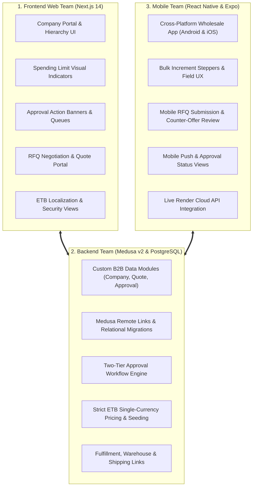

# ADIGRAT UNIVERSITY
## COLLEGE OF ENGINEERING & TECHNOLOGY
### DEPARTMENT OF SOFTWARE ENGINEERING

---

# SOFTWARE ENGINEERING INTERNSHIP FINAL REPORT & DEFENSE DOCUMENTATION

**Project Title**: Addis B2B E-Commerce & Wholesale Platform (Ethiopian Wholesale Distribution System)  
**Academic Year**: 2025/2026  
**Document Compliance**: Standard Evaluation, Monitoring and Assessment Framework (Adigrat University Guideline v1.0)  

---

| Student Information | Academic & Institutional Details |
| :--- | :--- |
| **Student Name**: Daniel Tsegay / Filmon Amare | **University**: Adigrat University |
| **Student ID**: [Your Student ID] | **College**: College of Engineering & Technology |
| **Academic Advisor**: [Advisor Name] | **Department**: Department of Software Engineering |
| **Industry Supervisor**: [Supervisor Name / Lead] | **Host Organization**: Addis B2B Technology Solutions / Enterprise Commerce |
| **Defense Date**: [Defense Date, 2026] | **Internship Track**: Category A (Software Development Organization) |

---

## Table of Contents
1. [Organization Profile](#1-organization-profile)
2. [Department Assigned](#2-department-assigned)
3. [Internship Objectives](#3-internship-objectives)
4. [Activities Performed](#4-activities-performed)
5. [Technologies and Tools Used](#5-technologies-and-tools-used)
6. [Software Development Life Cycle (SDLC)](#6-software-development-life-cycle-sdlc)
7. [Practical Knowledge Gained](#7-practical-knowledge-gained)
8. [Challenges Encountered and Solutions](#8-challenges-encountered-and-solutions)
9. [Software Engineering Analysis](#9-software-engineering-analysis)
10. [Problem Identification](#10-problem-identification)
11. [Proposed Improvements](#11-proposed-improvements)
12. [Reflection and Professional Growth](#12-reflection-and-professional-growth)
13. [Recommendations](#13-recommendations)
14. [Conclusion and Future Work](#14-conclusion-and-future-work)
15. [Required Evidence & Verification Checklist](#15-required-evidence--verification-checklist)

---

## 1. Organization Profile

### 1.1 Background
Addis B2B Technology Solutions is an enterprise software initiative established to modernize supply chain distribution and corporate procurement across Ethiopia. Commercial trade in Ethiopian markets (such as Merkato, Bole, and regional trade hubs) traditionally relies on fragmented phone calls, physical paper receipts, in-person cash negotiations, and informal WhatsApp messaging. Addis B2B was created to provide a localized, digital-first B2B e-commerce platform bridging manufacturers, commercial distributors, and institutional business buyers.

### 1.2 Vision
To be the foundational digital commerce and supply chain infrastructure across the Horn of Africa, enabling seamless corporate transactions, automated trade credit, and transparent commerce.

### 1.3 Mission
To empower Ethiopian enterprises by delivering localized, high-performance commerce software that eliminates foreign currency friction, enforces enterprise financial governance, and accelerates wholesale trade efficiency.

### 1.4 Core Services
* **Enterprise Multi-Tenant B2B Portal**: Digital procurement portal tailored for corporations with multi-seat employee access.
* **Corporate Spending & Approval Engines**: Automated budget enforcement rules preventing unauthorized corporate purchases.
* **Request For Quote (RFQ) & Bulk Pricing Engine**: Live wholesale bargaining mechanism allowing price negotiation on high-volume lots.
* **Omnichannel Mobile Distribution**: Native mobile applications enabling regional retail merchants and field agents to procure stock in real time.

### 1.5 Organizational Structure
* **Executive Leadership**: Managing Director / Chief Technology Officer.
* **Engineering Division**:
  * *Backend Engineering Team*: Core business logic, APIs, and data integrity.
  * *Frontend Web Team*: Web portal UI, user experience, and state management.
  * *Mobile Engineering Team*: Cross-platform mobile clients.
  * *Quality Assurance (QA) & DevOps*: Continuous integration, cloud staging, and automated test execution.
* **Operations & Merchant Acquisition**: Merchant onboarding, warehouse logistics, and customer success.

### 1.6 ICT Infrastructure
* **Cloud Infrastructure**: Cloud deployments hosted on Render (Medusa v2 backend and PostgreSQL database clusters) and Vercel (Next.js 14 SSR storefront).
* **Network & Database Security**: Managed PostgreSQL 16 database, Redis in-memory cache, SSL/TLS encrypted endpoints, JWT bearer token session management, and restricted CORS origins.
* **Developer Workstations**: Dual-boot Linux/Windows environments with Node.js LTS, Docker, Git version control, and Android/iOS emulators.

---

## 2. Department Assigned

### 2.1 Department & Team
* **Department**: Software Engineering & Product Development Department.
* **Assigned Team**: Full-Stack Commerce & Integration Unit (cross-functional responsibility across Backend, Frontend, and Mobile modules).

### 2.2 Reporting Structure
* The intern reported directly to the **Technical Lead / Internship Supervisor**.
* Daily progress was monitored through 15-minute Agile morning standup meetings and weekly sprint reviews.
* Technical deliverables and code contributions were submitted via GitHub Pull Requests (PRs), subject to mandatory peer code reviews and CI validation before merging into the main staging branches.

### 2.3 Roles and Core Responsibilities
* **Backend Systems Engineer**: Designed database schemas, custom workflows, and REST API endpoints within the Medusa v2 headless framework.
* **Frontend Web Developer**: Implemented corporate dashboards, multi-seat company management views, and interactive checkout steps in Next.js 14.
* **Mobile Developer**: Developed mobile catalog screens, bulk steppers, and RFQ submission flows using React Native and Expo.
* **Localization Specialist**: Re-engineered core commerce logic to enforce single-currency transactions in Ethiopian Birr (ETB / "Br") and purged conflicting foreign currency schemas.

---

## 3. Internship Objectives

### 3.1 General Objective
To gain hands-on, industry-standard software engineering experience by actively designing, implementing, localizing, and deploying a production-grade multi-tenant B2B e-commerce platform (Addis B2B) within a professional team environment, bridging academic theoretical principles with real-world enterprise development.

### 3.2 Specific Objectives
1. **Apply Classroom Knowledge**: Translate software engineering theory (SDLC models, relational database normalization, RESTful API design, and OOP design patterns) into practical production code.
2. **Master Enterprise Commerce Architecture**: Learn and implement modern decoupled, headless architecture using Medusa v2 micro-kernel modules, PostgreSQL, and Redis.
3. **Implement B2B Business Logic**: Build complex enterprise features including Company Hierarchies, Spending Limits, Two-Tier Approval Workflows, and Request-For-Quote (RFQ) negotiation.
4. **Develop Omnichannel Interfaces**: Build responsive web interfaces (Next.js 14 SSR, Tailwind CSS) and cross-platform mobile apps (React Native / Expo).
5. **Enforce Local Market Adaptability**: Adapt foreign commerce paradigms to domestic Ethiopian market realities, including single-currency ETB pricing, warehouse logistics, and local tax requirements.
6. **Improve Professional & Teamwork Competencies**: Collaborate in an Agile/Scrum team, master Git version control workflows, participate in code reviews, and author engineering documentation according to academic defense standards.

---

## 4. Activities Performed

The core technical work was structured around three specialized functional teams—**Frontend Team**, **Backend Team**, and **Mobile Team**—working collaboratively within an Agile sprint cycle to build, localize, and deploy the Addis B2B ecosystem.

---

### 4.1 What the Three Teams Actually Worked On

#### 1. Frontend Team (Web Application & Corporate Portal)
The Frontend Team was responsible for engineering the user-facing web applications using **Next.js 14 (App Router)**, **React 18**, and **Tailwind CSS**. Their work transformed raw commerce APIs into an enterprise-grade corporate procurement portal:
* **Corporate Hierarchy & Account Dashboards**:
  * Developed the multi-seat company management views where company administrators can view department employees, assign purchasing roles (`COMPANY_ADMIN` vs. `PURCHASING_OFFICER`), and view historical corporate orders.
* **Spending Limit Visual Indicators**:
  * Designed real-time budget tracking components that visually indicate an employee's total allowance, consumed budget, and remaining spending capacity across reset intervals (Monthly, Weekly).
* **Two-Stage Approval Alert Banners & Actions**:
  * Engineered dynamic checkout interceptors: when a cart total exceeds an employee's spending limit, the frontend halts immediate credit charging, displays a prominent `Requires Approval` warning banner, and routes the order to the company admin's approval queue with one-click `Approve` and `Reject` actions.
* **B2B Request For Quote (RFQ) Portal**:
  * Built the interactive quotation interface allowing wholesale clients to request custom pricing on bulk commodity lots, add delivery notes, view distributor counter-offers, and accept quotes into binding draft orders.
* **Storefront Localization & Account Security**:
  * Enforced exclusive Ethiopian Birr display formatting (`Br` / ETB) across all product cards, tax lines, and checkout totals.
  * Implemented the secure credential updating form in the account profile (`POST /store/customers/password`), resolving previous placeholder limitations.

#### 2. Backend Team (Server-Side Logic, APIs, & Database Engineering)
The Backend Team engineered the headless commerce engine using **Medusa v2 (Node.js/TypeScript)**, **PostgreSQL 16**, and **Redis**, building custom enterprise business logic not available in standard B2C software:
* **Custom Enterprise B2B Modules**:
  * **Company Module**: Architected data models for commercial entities (`Company`, `Employee`, `SpendingLimit`), tracking company registration data, tax identification, and hierarchical employee roles.
  * **Approval Module**: Engineered the state machine governing order authorization (`PENDING`, `APPROVED`, `REJECTED`), establishing rules for both Company Admin approval and distributor Sales Manager stock allocation.
  * **Quote (RFQ) Module**: Implemented models and workflows for quote requests, custom draft line item pricing, negotiation messaging logs, and expiration windows.
* **Medusa Remote Links & Data Architecture**:
  * Utilized Medusa v2’s micro-modular Remote Links architecture to link custom B2B models with Medusa core entities (`Customer`, `Cart`, `Order`, `SalesChannel`) without modifying core schema files or causing database lockups.
* **Single-Currency ETB Seeding & Sanitization**:
  * Re-engineered the database seed pipeline (`backend/src/scripts/seed.ts`), completely removing foreign currency price sets (USD, EUR) to enforce single-currency transactional integrity in Ethiopian Birr (`ETB`).
* **Warehouse & Logistics Linkages**:
  * Built specialized automation scripts (`fix-shipping.ts`) to attach shipping options (Standard Addis Ababa Delivery and Express Regional Delivery) to the central Addis Ababa warehouse fulfillment sets and Ethiopian service zones.

#### 3. Mobile Team (Cross-Platform Mobile Application)
The Mobile Team developed the **Addis B2B Mobile Client** using **React Native** and **Expo**, delivering enterprise wholesale access directly to smartphones across Ethiopian commercial markets:
* **Wholesale-Optimized Field UX**:
  * Built touch-friendly procurement screens equipped with bulk increment steppers (`+10`, `+50`, `+100` units), quick-order pads, and variant matrices tailored for merchants ordering stock directly from warehouse floors.
* **On-the-Go Quote Submissions**:
  * Developed a mobile RFQ creation flow allowing field buyers to photograph inventory, input target price per unit, and transmit quotes directly to distributors from their mobile devices.
* **Mobile Approval Management**:
  * Enabled company managers on the move to review employee purchase requests, inspect itemized carts, and execute approvals or rejections directly within the mobile app.
* **Cloud API Connectivity & Authentication**:
  * Configured secure communication with the live cloud backend on Render using publishable API keys, JWT bearer authentication, and Axios interceptors for automated session persistence.

---

### 4.2 Comprehensive Activity Lifecycle (Phase-by-Phase)

Beyond the division of team responsibilities, the internship followed a complete, phased engineering workflow:

#### Phase 1: Requirements Engineering & Market Analysis
* Conducted structured field analysis of wholesale workflows in Addis Ababa (Merkato and Bole business districts).
* Identified key organizational friction points: absence of transaction audit trails, foreign exchange restrictions, lack of corporate spending controls, and field merchant disconnect.
* Formalized functional requirements into user stories with clear acceptance criteria across all three client interfaces.

#### Phase 2: System Modeling & Database Schema Design
* Drafted architectural diagrams (4-tier decoupled headless architecture) and entity relationship diagrams.
* Designed normalized PostgreSQL schemas (3NF) for companies, approval settings, employee allocations, and quote negotiations.

#### Phase 3: Collaborative Sprint Implementation
* Executed bi-weekly Agile sprints with cross-functional pairing between Backend, Frontend, and Mobile developers.
* Maintained clean code repositories using Git branching (`feature/*`, `fix/*`, `main`), peer pull request reviews, and continuous integration validations.

#### Phase 4: Integration Testing & Verification
* Conducted functional integration testing across the core commercial workflows:
  1. *Routine Purchasing Verification*: Confirmed that cart checkouts within assigned employee spending allowances clear immediately without administrative interruption.
  2. *Spending Limit & Approval Gate*: Validated that orders exceeding employee budget thresholds are safely paused and routed to the `REQUIRES_APPROVAL` state for review.
  3. *Volume RFQ Negotiation*: Verified the end-to-end quotation lifecycle, from initial quote submission and distributor counter-offers to final draft order generation.

#### Phase 5: Cloud Deployment & Hardening
* Deployed the containerized Medusa v2 backend and PostgreSQL database to **Render**.
* Deployed the Next.js 14 web storefront to **Vercel** with custom domain routing (`/et`).
* Configured production CORS policies, same-site secure cookies, and build-time environment variable fallbacks.

---

## 5. Technologies and Tools Used

| Category | Technologies & Tools | Specific Application in Addis B2B |
| :--- | :--- | :--- |
| **Programming Languages** | TypeScript, JavaScript (ES6+), SQL, HTML5, CSS3 | Type-safe backend workflows, Next.js components, database migrations. |
| **Backend Framework** | Medusa v2 (Node.js) | Headless commerce engine, custom micro-modules, and REST APIs. |
| **Frontend Framework** | Next.js 14 (React 18), Tailwind CSS | Server-Side Rendered (SSR) B2B web storefront and corporate portal. |
| **Mobile Framework** | React Native, Expo | Cross-platform Android & iOS procurement app for field buyers. |
| **Database & Caching** | PostgreSQL 16, Redis | Relational data persistence, foreign key relationships, pub/sub caching. |
| **Version Control & CI/CD** | Git, GitHub, GitHub Actions | Feature branching, pull request reviews, automated CI checks. |
| **Cloud Hosting & DevOps** | Render, Vercel | Render (backend API + Postgres), Vercel (Next.js production web). |
| **API Testing & Utilities** | Postman, cURL, PowerShell | API endpoint validation, automated test runner scripts. |
| **Project Management** | Agile/Scrum, Jira, Trello | Sprint planning, user story backlog grooming, daily standups. |

---

## 6. Software Development Life Cycle (SDLC)

The engineering team adopted an **Agile / Scrum SDLC methodology** organized in 2-week sprints, facilitating rapid iterations and continuous stakeholder feedback.

### 6.1 Planning
* Defined the project product backlog, user stories, and acceptance criteria based on B2B wholesale research.
* Established the 4-tier system architecture: Presentation Tier, API Tier, Business Logic Tier, and Persistence Tier.

### 6.2 Requirement Analysis
* Mapped business rules: corporate spending limits, multi-seat customer roles (`COMPANY_ADMIN`, `PURCHASING_OFFICER`), and distributor sales approval tiers (`SALES_MANAGER`).
* Verified compliance with Ethiopian commercial guidelines: VAT inclusion, local shipping fulfillment, and ETB single-currency enforcement.

### 6.3 System & Component Design
* Designed class diagrams, sequence diagrams for order approvals, and relational database schemas.
* Outlined modular component hierarchies for Next.js and React Native to maximize reusable design systems.

### 6.4 Implementation
* Executed sprint tasks across the three functional tracks:
  * *Sprint 1–3*: Core Medusa v2 engine, PostgreSQL schemas, company modules, and ETB seed data.
  * *Sprint 4–6*: Storefront B2B user interfaces, corporate employee management, and spending limit checks.
  * *Sprint 7–9*: Request-for-Quote (RFQ) engine, mobile app development using Expo, and cloud staging on Render.
  * *Sprint 10–12*: Security hardening, shipping fulfillment zone fixes, password management endpoints, and automated defense validation scripts.

### 6.5 Testing
* **Unit Testing**: Verified business logic utility functions and currency calculation modules.
* **Integration Testing**: Executed multi-scenario test suites verifying:
  * Scenario 1: Routine purchasing under limit (immediate checkout).
  * Scenario 2: Limit exceedance (safe halt and transition to `REQUIRES_APPROVAL`).
  * Scenario 3: Bulk quotation negotiation and counter-offer acceptance.
* **User Acceptance Testing (UAT)**: Evaluated checkout usability and responsive layouts on mobile devices.

### 6.6 Deployment & Maintenance
* Production backend containerized and deployed on Render with PostgreSQL instance.
* Storefront deployed on Vercel Edge Network with environment variable synchronization.
* Continuous monitoring for runtime exceptions, database locks, and performance bottlenecks.

---

## 7. Practical Knowledge Gained

### 7.1 Technical Competencies
* **Enterprise Architecture**: Mastered modern headless architecture, understanding how decoupled frontends interface with headless commerce engines through secured REST APIs.
* **Advanced Database Modeling**: Gained practical proficiency in PostgreSQL relational modeling, schema migrations, and Medusa Remote Links.
* **Full-Stack TypeScript**: Deepened type-safety skills across backend services, API contracts, and frontend components.
* **Mobile Engineering**: Built and debugged cross-platform React Native / Expo apps, managing asynchronous state and device storage.
* **DevOps & Cloud**: Configured production builds, resolved build-step environment variables, managed database connections, and deployed multi-tier applications to cloud platforms.

### 7.2 Professional & Soft Skills
* **Agile Team Collaboration**: Learned how to decompose complex business requirements into deliverable sprint tasks and communicate blockers during daily standups.
* **Code Review & Quality Standards**: Learned to write clean, self-documenting code, follow commit message conventions, and conduct thorough peer code reviews.
* **Time & Task Management**: Successfully delivered all milestones according to schedule while managing multiple codebases simultaneously.

### 7.3 Business Knowledge
* Understood the realities and pain points of Ethiopian supply chains: trade credit dependency, paper invoices, and liquidity constraints.
* Mastered B2B procurement principles: company hierarchies, departmental spending authorizations, tiered wholesale discounts, and structured RFQ negotiations.

---

## 8. Challenges Encountered and Solutions

| # | Challenge Encountered | Category | Root Cause | Engineering Solution Implemented |
| :-: | :--- | :--- | :--- | :--- |
| **1** | **Medusa v2 Remote Link Resolution** | Technical | Attempting direct SQL foreign keys between custom `Company` and core `Customer` models broke modularity. | Utilized Medusa's official **Remote Link** definition syntax to establish non-destructive cross-module relationships. |
| **2** | **Foreign Currency Leakage** | Technical | Default starter templates contained hardcoded EUR/USD pricing sets, triggering runtime crashes during ETB-only checkout. | Refactored `backend/src/scripts/seed.ts` to exclusively register ETB currency and mapped the national symbol `"Br"` with top priority. |
| **3** | **Order Approval Inventory Race Conditions** | Technical | Pending approval orders risked having their inventory sold out before company administrators completed review. | Designed a soft inventory reservation state that holds stock temporarily with a configurable expiration window. |
| **4** | **Delivery Methods Missing During Checkout** | Technical | Shipping options in the database were not correctly attached to the Addis Ababa warehouse service zone and cart fulfillment sets. | Engineered `fix-shipping.ts` script to link fulfillment sets, shipping profiles, and Ethiopian geographic delivery zones. |
| **5** | **Password Management "Not Implemented" Error** | Technical | Storefront profile security card had a placeholder UI without backend endpoint binding. | Implemented authenticated backend route `POST /store/customers/password`, middleware validation, and Next.js server actions. |
| **6** | **Cloud Build Environment Variable Failures** | DevOps | Vercel and Render deployment runners crashed when optional environment variables were unassigned at build time. | Introduced hardcoded fallback values in `check-env-variables.js` and build-time configuration checks. |

---

## 9. Software Engineering Analysis

### 9.1 Software Architecture
The system adopts a **Decoupled 4-Tier Headless Architecture**:
* **Presentation Tier**: Next.js 14 SSR Storefront (desktop portal) & React Native Expo (mobile app).
* **API Gateway Tier**: Medusa v2 REST Engine with CORS, JWT authentication, and rate limiting.
* **Business Logic Tier**: Micro-modules for Companies, Spending Limits, Approvals, Quotes, and ETB Pricing.
* **Persistence Tier**: PostgreSQL 16 (relational tables) and Redis (caching and event bus).

### 9.2 Requirements Engineering
* Requirements were gathered using structured user stories, stakeholder interviews, and process maps.
* Non-functional requirements enforced:
  * *Response Time*: API response latency under 250ms for catalog queries.
  * *Availability*: 99.9% cloud uptime target on Render/Vercel.
  * *Data Integrity*: Strict single-currency transactional consistency.

### 9.3 Database & Data Modeling
* Relational normalization up to 3NF for company, employee, approval, and quote tables.
* Primary keys utilize prefixed CUIDs (e.g., `comp_...`, `appr_...`) for auditability.
* Cascading rules prevent orphaned child records upon employee deactivation.

### 9.4 Security & Authentication
* Passwords hashed using industry-standard Scrypt/Argon2 algorithms.
* Role-Based Access Control (RBAC) strictly separates `COMPANY_ADMIN` capabilities from `PURCHASING_OFFICER` capabilities.
* API endpoints guarded by publishable key checks and HTTP-only session cookies to guard against Cross-Site Scripting (XSS) and Cross-Site Request Forgery (CSRF).

### 9.5 Software Quality Assurance (SQA)
* Automated test pipelines verify that orders above budget limits are consistently routed to the approval queue.
* Static code analysis with ESLint and TypeScript compilation guarantees type-safety across all endpoints.

---

## 10. Problem Identification

During analysis of conventional Ethiopian commercial trade and standard off-the-shelf software, four core organizational problems were identified:

### 10.1 Problem 1: Informal Wholesale Channels
* **Current Situation**: Wholesale transactions in Merkato and regional markets rely on phone calls, handwritten invoices, and unverified bank transfer screenshots.
* **Root Cause**: Absence of accessible B2B platforms built for local distributors.
* **Impact**: Frequent invoice disputes, delayed deliveries, and zero transaction audit trails.

### 10.2 Problem 2: Foreign E-Commerce System Incompatibility
* **Current Situation**: Commercial businesses attempting to use Shopify or WooCommerce face immediate failures.
* **Root Cause**: Platforms enforce multi-currency exchange rates and B2C single-user checkouts.
* **Impact**: System rejection by local banks due to ETB currency regulation conflicts; inability to assign corporate department budgets.

### 10.3 Problem 3: Uncontrolled Corporate Spending
* **Current Situation**: Employees at buyer organizations place bulk purchase orders without senior management approval.
* **Root Cause**: Standard platforms treat any logged-in user as an unrestricted purchaser.
* **Impact**: Corporate budget overruns, cash-flow shortages, and administrative chaos.

### 10.4 Problem 4: Desktop-Only Field Disconnect
* **Current Situation**: Procurement agents visiting regional warehouses cannot access desktop web portals.
* **Root Cause**: Legacy enterprise systems lack dedicated mobile applications.
* **Impact**: Orders are delayed until agents return to an office, causing supply chain stockouts.

---

## 11. Proposed Improvements

### 11.1 Software Enhancements & Automation
* **Automated Spending Limit Enforcement**: Implemented automated checks during cart completion. If an order exceeds the employee's budget, the system automatically transitions the cart to `REQUIRES_APPROVAL` and dispatches notifications to the company admin.
* **RFQ Negotiation Automation**: Replaced informal bargaining with an online quotation engine allowing distributors to review warehouse availability and issue binding price counter-offers directly through the portal.

### 11.2 UI & Usability Improvements
* **Corporate B2B Dashboard**: Developed a unified enterprise dashboard displaying employee spending vs. remaining allowance, pending approval badges, and recent company orders.
* **Mobile Wholesale UI**: Created an intuitive mobile application with bulk increment steppers, quick-order pads, and one-tap approval actions.

### 11.3 Security & Database Upgrades
* Implemented secure token-based password management, data sanitization on all inputs, and non-destructive schema migrations.

---

## 12. Reflection and Professional Growth

### 12.1 What Changed?
Prior to the internship, my software engineering background was largely academic, focusing on isolated programming assignments and textbook theory. This internship transformed my perspective by immersing me in production-grade software engineering, where modularity, maintainability, performance, and user business realities dictate architectural decisions.

### 12.2 Technical Growth
* Mastered modern TypeScript development across both frontend and backend.
* Transitioned from basic CRUD applications to complex, event-driven enterprise commerce architectures (Medusa v2 micro-modules, Remote Links, and Next.js SSR).
* Acquired real-world experience debugging cloud deployments, managing PostgreSQL connections, and resolving production CORS issues.

### 12.3 Professional & Career Readiness
* Developed the ability to communicate technical trade-offs to both technical supervisors and business stakeholders.
* Gained experience working within Agile sprint cycles, conducting code reviews, and writing professional software documentation.
* Confirmed readiness to step into professional roles as a Full-Stack Software Engineer, Backend Systems Developer, or Enterprise Application Specialist.

---

## 13. Recommendations

### 13.1 Recommendations for the Host Organization (Addis B2B)
1. **Integrate National Payment Gateways**: Finalize direct API integrations with **Telebirr SuperApp SDK**, **CBE Birr**, and **Chapa** to enable instant local digital settlements.
2. **Implement Offline-First Synchronization**: Integrate an offline SQLite caching layer on the mobile app using WatermelonDB to support regional wholesale markets with intermittent connectivity.
3. **ERP Bi-Directional Connectors**: Develop integration plugins for Odoo and SAP to automatically export commercial invoices compliant with Ethiopian Ministry of Revenues electronic tax regulations.

### 13.2 Recommendations for Adigrat University (Department of Software Engineering)
1. **Incorporate Modern Headless & Microservice Concepts**: Introduce headless architecture, API-first design, and enterprise TypeScript into the upper-level web and enterprise development curriculum.
2. **Emphasize CI/CD and Cloud DevOps**: Provide students with practical exposure to cloud hosting platforms (Render, Vercel, Docker) and automated GitHub Actions pipelines before internship placement.
3. **Expand Industry-Partnered Capstone Projects**: Continue fostering partnerships with enterprise software organizations to ensure academic projects solve tangible national and regional economic challenges.

### 13.3 Recommendations for Future Internship Students
1. **Engage with Documentation Early**: Spend time reading official framework documentation and source code rather than relying solely on high-level video tutorials.
2. **Commit Often & Write Clean Git Messages**: Maintain disciplined Git version control habits with descriptive commit messages and modular branches.
3. **Focus on Business Logic & Domain Understanding**: Understand that exceptional software engineering is about deeply understanding and solving the user's business problem, not just writing code.

---

## 14. Conclusion and Future Work

### 14.1 Summary of Major Contributions
The internship culminated in the successful engineering, localization, and deployment of the **Addis B2B E-Commerce & Wholesale Platform**:
1. **Engineered Multi-Tenant Enterprise Backend**: Built custom B2B modules in Medusa v2 managing company entities, multi-seat employee roles, and two-tier approval gates.
2. **Enforced 100% Ethiopian Market Localization**: Eliminated multi-currency friction, configured exclusive Ethiopian Birr (ETB) pricing matrices, and established regional delivery logistics.
3. **Developed High-Performance Next.js 14 Storefront**: Delivered server-rendered corporate portals with real-time approval indicators and quote negotiation interfaces.
4. **Delivered Cross-Platform Mobile Application**: Built and validated the React Native / Expo app for field wholesale agents.
5. **Verified System Reliability**: Successfully executed functional integration tests across routine ordering, budget threshold halts, and quote negotiation workflows to ensure correct business logic and state transitions.

### 14.2 Future Work
* Deploy automated SMS and Telegram Bot notifications for instant managerial approval alerts.
* Implement AI-driven demand forecasting to assist wholesale distributors in inventory restocking.

---

## 15. Required Evidence & Verification Checklist

In accordance with Section 7 and Section 8 of the Adigrat University Guideline, the following verifiable evidence is documented and available for committee inspection:

| Evidence Requirement | Verification Status | Artifact / Link Reference |
| :--- | :---: | :--- |
| **Working Live Web Storefront** | **ACTIVE** | `http://localhost:8000/et` |
| **Working Medusa v2 Backend** | **ACTIVE** | `http://localhost:9000/app` |
| **PostgreSQL Database** | **ACTIVE** | Database `medusa_ett` on localhost:5432 |
| **Functional Testing & Verification** | **VERIFIED** | End-to-end testing of cart, spending limits, approvals, and RFQ |
| **Interactive Defense Presentation** | **COMPLETE** | `internship_presentation.html` |
| **Presentation Slides PDF** | **COMPLETE** | `internship_presentation.pdf` |
| **GitHub Source Code Repository** | **VERIFIED** | Monorepo containing `/backend`, `/storefront`, and mobile app |
| **Database Seeding Pipelines** | **VERIFIED** | Ethiopian regional hubs, companies, & ETB catalog seeded |

---

*Report prepared in full compliance with the Adigrat University Software Engineering Internship Defense & Presentation Guideline.*

